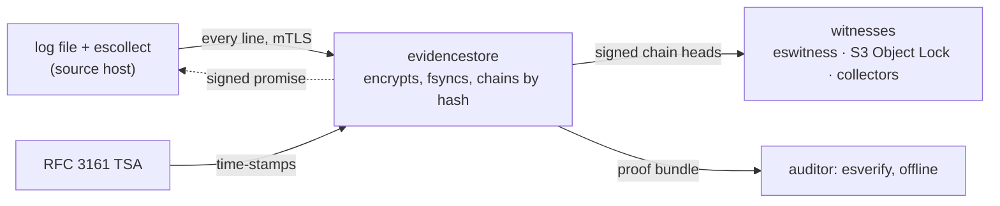

<p align="center">
  <picture>
    <source media="(prefers-color-scheme: dark)" srcset="docs/assets/logo-dark.svg">
    
  </picture>
</p>

<p align="center">
  <a href="https://github.com/Nikolay1994Kaz/evidencestore/actions/workflows/ci.yml"></a>
  <a href="https://github.com/Nikolay1994Kaz/evidencestore/releases"></a>
  <a href="go.mod"></a>
  <a href="LICENSE"></a>
</p>

<p align="center"><b>Tamper-evident storage for audit logs, with proofs an auditor checks offline.</b></p>

A log usually lies on the machine it describes, so whoever controls that machine controls its log: an intruder cleans `auth.log`, an administrator or an AI agent edits away what it did. evidencestore keeps every line where they cannot reach it. A collector next to the log sends each line to a store on another machine, and for any line the store gives a proof bundle that the auditor checks with `esverify`, offline and without trusting the store.



- **Deleted lines come back.** The store keeps every record byte for byte, each encrypted under its own key, and `esverify -body` writes a verified record out exactly as the source sent it.
- **Proof, not trust.** A bundle carries the record, its Merkle path into the hash chain, a head signed by the store and RFC 3161 time-stamps from before and after it. One changed byte fails the check.
- **Nothing left out.** A bundle over a window of time, for one source, for every source or for one subject inside a source, proves that it holds every record the store put into its chain in that window.
- **The store's administrator is checked too.** Signed chain heads go to witnesses out of that administrator's reach: an `eswitness` that cosigns only heads that extend the last one it cosigned, an S3 bucket with Object Lock, the collectors themselves. A history rewritten after they saw it contradicts what they hold.
- **Retention by destroying keys.** The records of a source for a month share that month's key. Destroying it, after a waiting period and two named approvals, makes those bodies unreadable in every copy, while the proofs that the records existed and never changed stay valid.

What the auditor sees (`esverify` on a bundle from a store with a witness, abridged):

```
$ esverify -proof proof.json -store-key store.pub -tsa-trust tsa-root.crt -witness-key "$WITNESS"
VERIFIED

Record: source app, number 2, type "text"
Received by the store: 2026-11-08 21:11:33 UTC (by its clock)
Entered the chain between T1 = 2026-11-08 21:11:30 UTC and T2 = 2026-11-08 21:11:37 UTC (TSA time-stamps)

Checks:
  ✔ the chain leaf describes this very record — position 2
  ✔ the links are chained by hash with no gaps — 5 links
  ✔ the head is signed with the store key — head 8
  ✔ the record is in a chain link (Merkle path) — link 7
  ✔ a TSA time-stamp over the chain after the record (not later than T2) — T2 = 2026-11-08 21:11:37 UTC, head 8
  ✔ the body opens with the record key in the bundle, the key is bound to the digest, the GCM tag matches — 74 bytes
  ✔ every witness given with -witness-key cosigned a head at or after this point, and the chain in the bundle agrees with it — witness.example/w1 (key 2bbc0e6e): head 7, cosigned at 2026-11-08 21:11:36 UTC

Body:
2026-11-09T02:11:34+05:00 user=alice action=export table=clients rows=1200
```

It takes any line-based log: system logs, application and core banking audit logs, a copy of the SIEM stream, the flight recorder of an AI agent gateway such as [Pipelock](https://github.com/luckyPipewrench/pipelock), whose own hash chain and signatures the store also checks at intake. Time-stamps come from any RFC 3161 service, e.g. the National Certification Authority of Kazakhstan (`tsp.pki.gov.kz`). What a bundle proves and what it does not, exactly: [What is proven, and what is not](#what-is-proven-and-what-is-not).

## Try it

The demos run on Linux with bash, python3 and Go 1.25.4 or newer (the Pipelock one also needs curl). With binaries from a release, `ES_BIN=/usr/local/bin` runs them without Go ([Install](#install)).

```sh
git clone https://github.com/Nikolay1994Kaz/evidencestore && cd evidencestore
scripts/demo.sh                    # builds everything, runs a full scenario offline
DEMO_TSA=digicert scripts/demo.sh  # same, time-stamps from the public DigiCert TSA
DEMO_TSA=nca scripts/demo.sh       # same, time-stamps from the NCA of Kazakhstan
scripts/demo-intruder.sh           # an intruder cleans auth.log; every deleted line comes back from the store
PIPELOCK_BIN=$(which pipelock) scripts/demo-pipelock.sh  # a real Pipelock gateway, see below
```

The demo runs these steps:

1. Issues demo certificates and starts the store.
2. Ships three log lines through the collector.
3. Verifies a proof with `esverify`.
4. Shows that a one-byte forgery is caught.
5. Destroys the month key (a single approval is refused) and shows that the proof still verifies while the body is gone.

`scripts/demo-intruder.sh` plays an intrusion on a web server: an intruder logs in as root and removes every line with their address from a practice `auth.log` (inside the demo directory; nothing on the host is touched). The script pulls the records of that source out of the store and verifies each one offline: the four deleted lines come back byte for byte, and the time-stamps show they were in the store before the file was rewritten. Last, it asks for the whole session of web-1 as one bundle, which would not verify with any line left out (this waits two minutes for the time-stamps that close the window).

## Run it yourself

The first three steps of the demo, by hand and on a log of your own, on one Linux machine. You need `evidencestore`, `escollect` and `esverify` on your `PATH`: from a release ([Install](#install)), or `go install ./cmd/...` in the clone.

`dev-setup` prepares a new or empty directory for a try: demo certificates, both configs with the store's public key pinned in the collector's, and `init`. Time-stamps come from a demo TSA built into the store, so nothing leaves the machine. `-log FILE` points the collector at a log of your own, and `-port` moves the store off port 8443:

```sh
evidencestore dev-setup -dir ~/es-try -source app
```

<details>
<summary>Step by step by hand: certificates, both JSON configs and <code>init</code></summary>

`dev-pki` writes a demo CA, a server certificate and a client certificate for the source `app` into `pki/` (the store takes the source name from the certificate's CommonName). The last line `init` prints is the store's public key: the collector pins it as `store_key`, and an auditor passes it to `esverify`:

```sh
mkdir -p ~/es-try && cd ~/es-try
evidencestore dev-pki -source app
cat > store.json <<'EOF'
{
  "data_dir": "data",
  "roots_dir": "roots",
  "listen": "127.0.0.1:8443",
  "tls": {"cert": "pki/server.crt", "key": "pki/server.key", "client_ca": "pki/ca.crt"},
  "tsa": {"url": "local"},
  "sources": [{"name": "app", "content_type": "text"}]
}
EOF
evidencestore init -config store.json | tee init.txt
tail -1 init.txt > store.pub
cat > collector.json <<EOF
{
  "server": "https://127.0.0.1:8443",
  "ca": "pki/ca.crt", "cert": "pki/app.crt", "key": "pki/app.key",
  "store_key": "$(cat store.pub)",
  "spool_dir": "spool",
  "file": "app.log", "from_start": true
}
EOF
```

</details>

Start the store in a second terminal and leave it running. Its warnings that `keys.backup_dir` is not set and, two minutes later, that the collector of `app` is lost are fine for a try:

```sh
cd ~/es-try && evidencestore serve -config store.json
```

Back in the first terminal, write a line into `app.log` and send it (with `-log`, skip the `echo`: record 1 is the first line of your log). With `-once` the collector sends what the file holds and exits; as a service it follows the file:

```sh
cd ~/es-try
echo "$(date -Is) user=alice action=login" >> app.log
escollect -config collector.json -once
```

Now a proof of record 1, checked the way an auditor does it. A bundle verifies only once a time-stamp lies over the chain after its record: the store takes one every 10 minutes, and `stamp` takes one now. `-dek` adds the key of this one record, so `esverify` also prints the body:

```sh
evidencestore stamp -config store.json
evidencestore proof -config store.json -source app -seq 1 -dek -out proof.json
evidencestore tsa-root -config store.json -out tsa-root.crt
esverify -proof proof.json -store-key store.pub -tsa-trust tsa-root.crt
```

`esverify` ends with `VERIFIED` (exit code 0), and `evidencestore status -config store.json` shows what the store holds. A real installation also needs certificates from your own PKI, a real TSA, key backups on other disks and the store on another machine than its sources: [Installing on hosts](docs/install.md). To start over, stop the store and remove `~/es-try`.

## How it works

1. **Collect.** `escollect` tails the log, numbers every line and keeps it in a spool on disk until the store has signed for it.
2. **Accept.** The store takes each line over mutual TLS, encrypts it as a record with its own key, writes it to disk and answers only after `fsync`, with a signed promise the collector keeps.
3. **Chain.** Records are chained by hash. A chain head is a signed checkpoint: the number of links and the root of a Merkle tree over all of them.
4. **Time-stamp.** An external RFC 3161 authority time-stamps the head; a second one, of another operator, can vouch for the first should its key ever be compromised ([Revoked TSA certificates](docs/bundles.md#revoked-tsa-certificates)).
5. **Witness.** Whoever holds the store's signing key could sign a second version of the chain, so the heads also go where that administrator cannot reach: to cosigning witnesses, to an S3 bucket with Object Lock and to every collector ([Copy, restore and the witness](docs/copy-and-witness.md)).
6. **Prove.** For one record, or for a window of time, the store builds a proof bundle, and an auditor checks it offline, without access to the store and without trusting it.
7. **Forget.** The records of a source for a month share that month's key; destroying it makes those bodies unreadable in every copy, while the chain and the proofs stay intact ([Keys and retention](docs/keys.md)).

## Components

| Binary | Role |
|---|---|
| `evidencestore` | the store: `init`, `serve`, `restore`, `dev-pki` (demo certificates), `dev-setup` (a demo store in one directory: certificates, both configs, `init`), plus operator commands over a local admin socket (`status`, `statement`, `stamp`, `proof`, `tsa-root`, `keys …`, `sources bind`) |
| `escollect` | collector next to the source: tails a log file (or a set of files by glob), numbers lines, spools them on disk, delivers them over mTLS, keeps the store's signed promises |
| `eswitness` | a witness that cosigns the store's chain heads (C2SP tlog-witness), run by someone other than the store's administrator: `init`, `serve`, `vkey` (the key auditors pass to `esverify -witness-key`) |
| `esverify` | auditor's tool: verifies a proof bundle offline and prints what is and is not proven; exit code 0 means verified, 1 not verified, 2 a bad call or an unreadable file ([exit codes in full](docs/what-is-proven.md#exit-codes-of-esverify)) |

`evidencestore version`, `escollect -version`, `eswitness version` and `esverify -version` print the version and the commit a binary was built from.

## Install

The store, the collector and the witness run on Linux (amd64, arm64). `esverify` also runs on macOS and Windows: an auditor needs nothing else.

**From a release.** Download the binaries and `SHA256SUMS` from [Releases](https://github.com/Nikolay1994Kaz/evidencestore/releases), then check the checksum and where the binary was built: the attestation shows that this repository's release workflow built the file from the tagged commit.

```sh
sha256sum -c SHA256SUMS --ignore-missing
gh attestation verify evidencestore-linux-amd64 --repo Nikolay1994Kaz/evidencestore
sudo install -m 0755 evidencestore-linux-amd64 /usr/local/bin/evidencestore   # likewise escollect, eswitness, esverify
evidencestore version
```

**With Go** 1.25.4 or newer: `go install github.com/Nikolay1994Kaz/evidencestore/cmd/esverify@latest`, likewise `cmd/evidencestore`, `cmd/escollect` and `cmd/eswitness`.

**From source.** With Go 1.25.4 or newer: `git clone https://github.com/Nikolay1994Kaz/evidencestore && cd evidencestore && go build -o /usr/local/bin/ ./cmd/...`.

**On hosts.** The store, a collector for each source and a witness as systemd services, with the unit files from [`configs/systemd/`](configs/systemd): [Installing on hosts](docs/install.md). The store runs under its own user, with `keys.backup_dir` and `keys.roots_mirror_dir` on other disks; the witness is run by someone other than the store's administrator.

There is no container image yet.

## Documentation

- [What is proven, and what is not](docs/what-is-proven.md): every claim a verified bundle supports, the flag that gives it, and the exit codes of `esverify`.
- [Installing on hosts](docs/install.md): the store, collectors and a witness as systemd services.
- [Configuration](docs/configuration.md): the store and the collector, values refused at start, upgrading.
- [Keys and retention](docs/keys.md): month keys, their backup and the roots mirror, destruction, a seal of your organization on the store key.
- [Copy, restore and the witness](docs/copy-and-witness.md): the remote copy, `restore`, the witness of the chain heads, witnesses that cosign them (`eswitness`).
- [Bundles over a window of time](docs/bundles.md): everything received in a window, for one source or for all, for one subject inside a source, and the collector's promise.
- [Gateway journals (Pipelock)](docs/pipelock.md): the flight recorder of an AI agent gateway, checked at intake.
- [Monitoring](docs/monitoring.md): what to alert on.
- [Known limitations](docs/limitations.md), [How it was tested](docs/testing.md), [release notes](docs/releases/).

## What is proven, and what is not

| Who could cheat | What shows it | What the auditor brings |
|---|---|---|
| Someone on the source host edits or deletes log lines | the store holds every line as it received it, byte for byte, and TSA time-stamps from before and after bound when it entered the chain | the bundle, the store key, the TSA root |
| Someone changes a record inside the store | the record no longer matches its leaf, its Merkle path or the signed head | the same |
| The store leaves a record out of its answer | a bundle over a window of time holds every record the store put into its chain in that window; a record held back past the window misses the deadline the store promised the collector | `-from` and `-to`, the collector's promise with `-promise` |
| The store's administrator rewrites the chain and signs it again | the new chain has only fresh time-stamps and contradicts the heads that witnesses and collectors hold | `-witness-key` or `-heads` |
| The TSA's key is stolen and its certificate revoked | a second TSA or a witness shows that the time-stamp existed before the revocation | `-tsa-crl`, the root of the second TSA or `-witness-key` |
| The operator hands the auditor a store key that is not the organization's | a seal of the organization's X.509 certificate on the store key | `-seal-trust` and `-seal-subject` |

Not proven:

- that the content is true: a lying source is recorded faithfully;
- anything before the record reached the store, or about records the source never wrote;
- from a single-record bundle, that you were given every record;
- that the store was not rewritten, by the store alone: root on its host can delete or rewrite its files, and nothing prevents that. It leaves traces (fresh time-stamps, the collectors' promises, the heads witnesses hold), and they help only someone who checks them. Keep the store, its remote copy and the sources under different administrators where you can.

A bundle needs a time-stamp after its record: without one only the store's own signature dates the record, and `esverify` rejects such a bundle unless told `-allow-no-tsa`. The pilot cryptography (AES-256-GCM from the Go standard library, root keys in files) is not certified.

Every claim in full, with its conditions: [docs/what-is-proven.md](docs/what-is-proven.md).

## How it was tested

The test gate with the race detector runs on every push. On the code of v0.4.0, 650 bugs were injected one at a time, and every one of them made a test fail; the set has since grown to 1157, and those have not all been run together since. Randomized simulations of crashes, clocks, the collector and a dishonest store owner ran thousands of scenarios each on the code of v0.4.0, with shorter runs on the code after it, and none failed. The store ran a night on real logs and a live Pipelock, and the witness and the copy were tried on MinIO with Object Lock, not yet on AWS. Numbers, dates and commands: [docs/testing.md](docs/testing.md). Every finding of the code review, how it was reproduced and how it was fixed: [docs/dev/FINDINGS.md](docs/dev/FINDINGS.md), in Russian.

## Known limitations

About thirty, each with its cause: [docs/limitations.md](docs/limitations.md). The ones to read before a pilot: the collector reads files only; the two approvals of a key destruction are recorded but not enforced; indexes are kept in memory; a record changed on disk stops the next start until `data_dir` is restored from a copy; the seal on the store key does not support ГОСТ; the cryptography is not certified. What a bundle for one subject does not show is in [docs/bundles.md](docs/bundles.md).

## Development

GitHub Actions runs the same gate on every push to master and every pull request (`.github/workflows/ci.yml`). A `v*` tag also builds the release binaries with `scripts/release.sh`, attests where they were built and publishes the release with notes from `docs/releases/`.

```sh
go build ./... && go vet ./... && go test -race ./...
scripts/release.sh dist               # release binaries and SHA256SUMS
ES_BIN=/usr/local/bin scripts/demo.sh # the demo on installed binaries instead of a fresh build
python3 scripts/mutate.py keyring     # mutation testing: every injected bug must fail a test
                                      # sets: keyring, evlog, tsa, store, edge, auditchain, gateway, config, ship, cosign
```

The simulations and how to replay a failing scenario: [docs/testing.md](docs/testing.md#simulations).

Code comments, commit messages and the notes in [`docs/dev/`](docs/dev/) are in Russian: a code map, the design decisions and open questions, and the log of every finding of the code review. Everything a user of the product sees is in English.

## License

Apache License 2.0, see [`LICENSE`](LICENSE).
