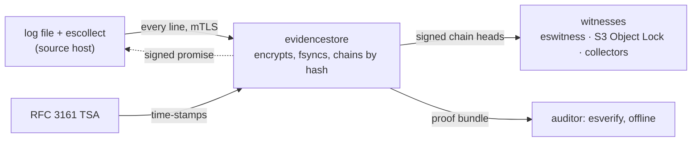

# How it works

[← README](../README.md)

1. **Collect.** `escollect` tails the log, or reads a PostgreSQL database's log by logical replication, numbers every record and keeps it in a spool on disk until the store has signed for it.
2. **Accept.** The store takes each line over mutual TLS, encrypts it as a record with its own key, writes it to disk and answers only after `fsync`, with a signed promise the collector keeps.
3. **Chain.** Records are chained by hash. A chain head is a signed checkpoint: the number of links and the root of a Merkle tree over all of them.
4. **Time-stamp.** An external RFC 3161 authority time-stamps the head; a second one, of another operator, can vouch for the first should its key ever be compromised ([Revoked TSA certificates](bundles.md#revoked-tsa-certificates)).
5. **Witness.** Whoever holds the store's signing key could sign a second version of the chain, so the heads also go where that administrator cannot reach: to cosigning witnesses, to an S3 bucket with Object Lock and to every collector ([Copy, restore and the witness](copy-and-witness.md)).
6. **Prove.** For one record, or for a window of time, the store builds a proof bundle, and an auditor checks it offline, without access to the store and without trusting it.
7. **Forget.** The records of a source for a month share that month's key; destroying it makes those bodies unreadable in every copy, while the chain and the proofs stay intact ([Keys and retention](keys.md)).

## Components

| Binary | Role |
|---|---|
| `evidencestore` | the store: `init`, `serve`, `restore`, `dev-pki` (demo certificates), `dev-setup` (a demo store in one directory: certificates, both configs, `init`), plus operator commands over a local admin socket (`status`, `statement`, `stamp`, `proof`, `tsa-root`, `keys …`, `sources bind`) |
| `escollect` | collector next to the source: tails a log file (or a set of files by glob) or reads PostgreSQL's log by logical replication, numbers the records, spools them on disk, delivers them over mTLS, keeps the store's signed promises; one process can run several sources |
| `eswitness` | a witness that cosigns the store's chain heads (C2SP tlog-witness), run by someone other than the store's administrator: `init`, `serve`, `vkey` (the key auditors pass to `esverify -witness-key`) |
| `esverify` | auditor's tool: verifies a proof bundle offline and prints what is and is not proven; exit code 0 means verified, 1 not verified, 2 a bad call or an unreadable file ([exit codes in full](what-is-proven.md#exit-codes-of-esverify)) |
| `esreceipt` | for a gateway that writes [signed receipts](receipts.md) of its agent's actions: `keygen`, `sign` (steps on stdin into the receipts file), `verify` (a receipts file, by the store's rules) |
| `esmcp` | an MCP server for an AI agent on PostgreSQL: runs the agent's SQL in its own transaction, under limits, and writes a signed intent before it and the outcome after ([PostgreSQL and an MCP server](postgres.md)) |
| `esundo` | the operator's undo of an agent's transaction from the rows the store holds: `check` (the plan, compared with the database) and `apply` |

`evidencestore version`, `escollect -version`, `eswitness version`, `esverify -version`, `esreceipt version`, `esmcp -version` and `esundo version` print the version and the commit a binary was built from.
